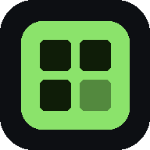

<div align="center">



# Assets Manager

**A free, browser-based toolkit for game assets.**<br>
Sprite sheets · trim & background removal · lossless compression · batch rename · GIF / MP4 / WebM export

[**▶ Open the app**](https://drehdantas.github.io/assets-manager/) &nbsp;·&nbsp;
[Tutorial](docs/TUTORIAL.md) &nbsp;·&nbsp;
[Download single-file version](https://drehdantas.github.io/assets-manager/assets-manager.html) &nbsp;·&nbsp;
[Changelog](CHANGELOG.md)


</div>

---

## Why

Drawing tools export every frame at the full canvas size, with lots of empty space, odd names and heavy files. Turning that into engine-ready sprites usually means juggling several websites and tools.

**Assets Manager does the whole pipeline in one place**: organize → trim → build the sprite sheet → compress → preview → export. Everything runs **100% locally in your browser**: no uploads, no account, no server. Your art never leaves your computer.

## Features

| Tool | What it does |
|---|---|
| 📁 **Library** | Projects and folders, drag & drop upload, file counts per folder, "new files" indicators, preview with zoom, move between folders, ZIP download. |
| ▦ **Sprite Sheet** | Build sheets from images, GIFs or videos. Drag frames to reorder; grid, horizontal or vertical layout; padding, margin, alignment (including *feet on the ground*); scale with nearest-neighbor for pixel art; power-of-two size. Exports **PNG + JSON atlas** (TexturePacker-style hash format). |
| ✂ **Trim** | Removes empty space automatically, per image or with **one shared box** so animations don't jitter. **Manual crop editor** with handles, plus **background removal** that floods in from the edges, so matching colors inside the sprite are kept. Optional halo cleanup. |
| ⇣ **Compress** | Builds optimized PNG, PNG-8 (palette), WebP and JPEG variants, measures quality (PSNR) and **recommends the smallest file without visible loss**. Detects pixel art, where PNG-8 is 100% lossless. Includes a before/after slider and a difference view. |
| ▶ **Animation** | Player for GIF, MP4/WebM and sprite sheets: play/pause, loop, ping-pong, FPS, frame stepping, backgrounds and zoom. Extracts frames from videos. |
| 🎞 **Export** | **GIF, MP4 (H.264) and WebM (VP9)** at sprite scale, or with **social media presets** (Instagram, Reels/TikTok/Shorts, Stories, YouTube, X, LinkedIn, Facebook, Bluesky, Discord, Steam, itch.io). Length is always a **whole number of loops**, within each platform's limit. |
| ☰ **Batch** | Rename many files with patterns (`hero_run_{n}`), numbering, find & replace (with regex) and case styles (snake_case, kebab-case, PascalCase…). Optionally convert to PNG/WebP/JPG and resize. Apply to the library, save copies or download a ZIP. |
| ↶ **History** | Undo and redo (Ctrl+Z / Ctrl+Shift+Z) for library changes and tool edits, plus a history list to jump back to any step. |
| 💾 **Storage** | Saves in the browser by default, or **straight to a folder on your computer** (Chrome/Edge), one sub-folder per project. Sprite sheets keep their `.json` next to the `.png`. |

<table>
<tr>
<td></td>
<td></td>
</tr>
<tr>
<td></td>
<td></td>
</tr>
</table>

## Quick start

### Option 1 — use it online (recommended)
Open **https://drehdantas.github.io/assets-manager/** in Chrome or Edge.
To install it as a desktop app, click the **Install** icon in the address bar (or ⋮ → *Install Assets Manager*). It then opens in its own window, gets a taskbar icon and **works offline**.

### Option 2 — single file, no internet needed
Download [`assets-manager.html`](https://drehdantas.github.io/assets-manager/assets-manager.html) and double-click it. Everything, including the video encoders, is inside that one file.

### Option 3 — run from source
```bash
git clone https://github.com/drehdantas/assets-manager.git
cd assets-manager
npm start            # serves the app at http://localhost:5173
```
There is no build step: `index.html` loads plain JavaScript files. Any static server works, for example `python -m http.server`.

👉 **New here? Read the [step-by-step tutorial](docs/TUTORIAL.md).**

## Browser support

| Feature | Chrome / Edge (desktop) | Other browsers |
|---|:-:|:-:|
| Library, Sprite Sheet, Trim, Compress, Batch, GIF export | ✅ | ✅ |
| Frame-by-frame GIF playback (ImageDecoder) | ✅ | ⚠️ depends on the browser; falls back to normal playback |
| MP4 / WebM export (WebCodecs) | ✅ | ⚠️ depends on the browser; the button is disabled if unsupported |
| Save straight to a computer folder | ✅ | ❌ use **Export ZIP** instead |

Use **Chrome or Edge on desktop** for the full experience; it's what the app is tested on.

## Keyboard shortcuts

| Shortcut | Action |
|---|---|
| `Ctrl+Z` / `Ctrl+Shift+Z` (or `Ctrl+Y`) | Undo / redo |
| `Ctrl+A` | Select all visible files (Library) |
| `Delete` | Delete selected files (Library) |
| `Esc` | Clear selection / close dialogs |
| `Space` | Play / pause (Animation & Sprite Sheet) |
| `←` / `→` | Previous / next frame |
| Ctrl/Shift + click | Multi-select / range-select cards |

## Project details

### How it works
- **Plain HTML, CSS and JavaScript**, no framework and no build step. All image processing uses the Canvas API.
- **PNG encoder** written from scratch, with adaptive scanline filters, `CompressionStream` deflate and a palette (PNG-8) mode with median-cut + k-means color quantization and optional Floyd–Steinberg dithering.
- **Quality metric**: alpha-aware PSNR, computed only over visible pixels so large transparent areas don't inflate the score.
- **GIF encoder** written from scratch (LZW, global palette, transparency, per-frame delays with drift correction).
- **Video export** uses [WebCodecs](https://developer.mozilla.org/docs/Web/API/WebCodecs_API) (`VideoEncoder`) for frame-exact timing, muxed with [mp4-muxer](https://github.com/Vanilagy/mp4-muxer) and [webm-muxer](https://github.com/Vanilagy/webm-muxer).
- **Background removal**: breadth-first flood fill from the image borders, with tolerance, soft edges and un-premultiplying of the background color ("defringe").
- **Storage**: IndexedDB in the browser, or the [File System Access API](https://developer.mozilla.org/docs/Web/API/File_System_API) for a real folder on disk.
- **PWA**: web manifest + service worker for installation and offline use.

### Folder layout created for each project
```
Assets Manager/            ← the folder you connect
└── My Game/               ← one folder per project
    ├── originals/         ← your raw exports
    ├── trim/              ← cropped images
    ├── spritesheets/      ← sheet.png + sheet.json
    ├── compressed/        ← optimized files
    ├── frames/            ← frames extracted from GIF/video
    └── exports/           ← GIF / MP4 / WebM / batch output
```

### Sprite sheet JSON
Each sheet is saved with a JSON atlas in the common *hash* format (works with Phaser, PixiJS and most TexturePacker importers), plus an `meta.am` block that Assets Manager uses to re-open the grid:
```json
{
  "frames": { "slime_idle_00": { "frame": { "x": 0, "y": 0, "w": 176, "h": 184 }, "duration": 83 } },
  "animations": { "slime_idle": ["slime_idle_00", "slime_idle_01"] },
  "meta": { "image": "slime_idle.png", "size": { "w": 710, "h": 370 },
            "am": { "cols": 4, "rows": 2, "frameW": 176, "frameH": 184, "padding": 2, "fps": 12 } }
}
```

### Source structure
```
index.html              app shell (markup)
css/style.css           all styles
js/core.js              utilities, dialogs, ZIP writer, image helpers, PNG encoders, quantizer, PSNR
js/storage.js           browser (IndexedDB) and disk (File System Access) back-ends
js/player.js            animation player + controls
js/media.js             background removal, GIF/video encoders, export dialog, crop editor, menus, undo history
js/app.js               projects, folders, library, history-aware file operations, startup
js/tools.js             Sprite Sheet, Compress and Animation tools
js/trim_batch.js        Trim and Batch tools
vendor/                 mp4-muxer and webm-muxer (MIT)
scripts/build-single.mjs  builds dist/assets-manager.html (one self-contained file)
sw.js, manifest.webmanifest, icons/   installable app / offline support
.github/workflows/pages.yml           deploys to GitHub Pages on every push to main
```

### Privacy
No analytics, no tracking, no uploads. The only network requests are the Google Fonts stylesheet (optional; the app falls back to system fonts) and, for the online version, the app's own files.

## Roadmap

- [ ] Edge extrusion (bleeding) to avoid lines between sprites in engines
- [ ] Bin-packed atlases for sprites of different sizes
- [ ] Engine exports: Godot `SpriteFrames` (`.tres`), Unity sliced sprite, Phaser multi-atlas
- [ ] Per-frame pivot / anchor points
- [ ] Onion skin and animation tags in the player
- [ ] "Watch folder": auto-trim and compress new exports from your drawing app
- [ ] Desktop build (Tauri) for native folder watching

Suggestions and bug reports are welcome in [Issues](https://github.com/drehdantas/assets-manager/issues).

## Contributing

1. Fork the repository and create a branch: `git checkout -b feature/my-idea`
2. Run `npm start` and edit the files in `js/`, `css/` or `index.html`
3. Bump `VERSION` in `sw.js` when you change cached files
4. Open a pull request describing the change

## License

[MIT](LICENSE) © 2026 André Dantas de Campos.

Third-party code: [mp4-muxer](https://github.com/Vanilagy/mp4-muxer) and [webm-muxer](https://github.com/Vanilagy/webm-muxer) © Vanilagy, MIT. See [THIRD_PARTY_NOTICES.md](THIRD_PARTY_NOTICES.md).
