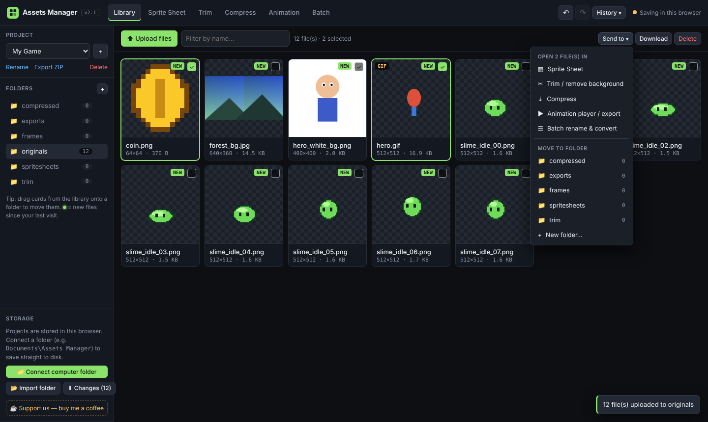
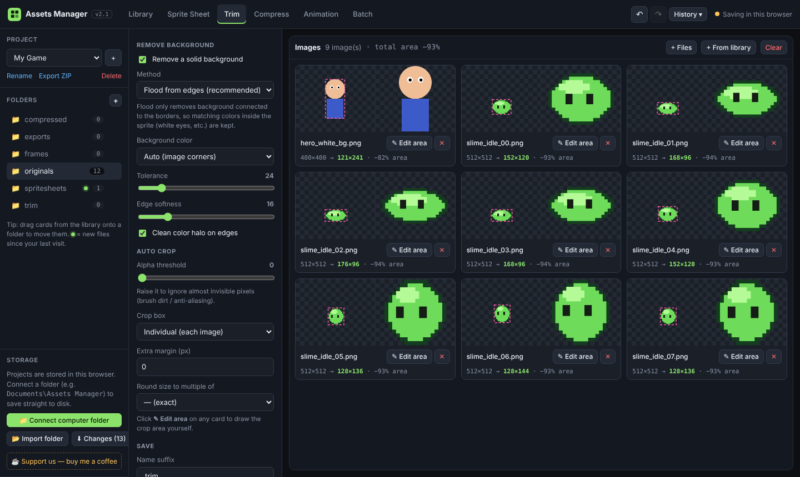
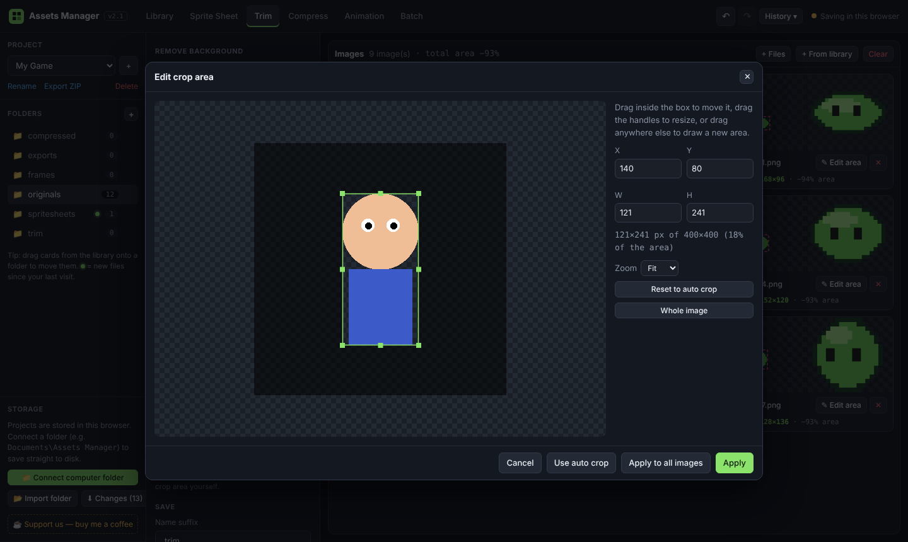
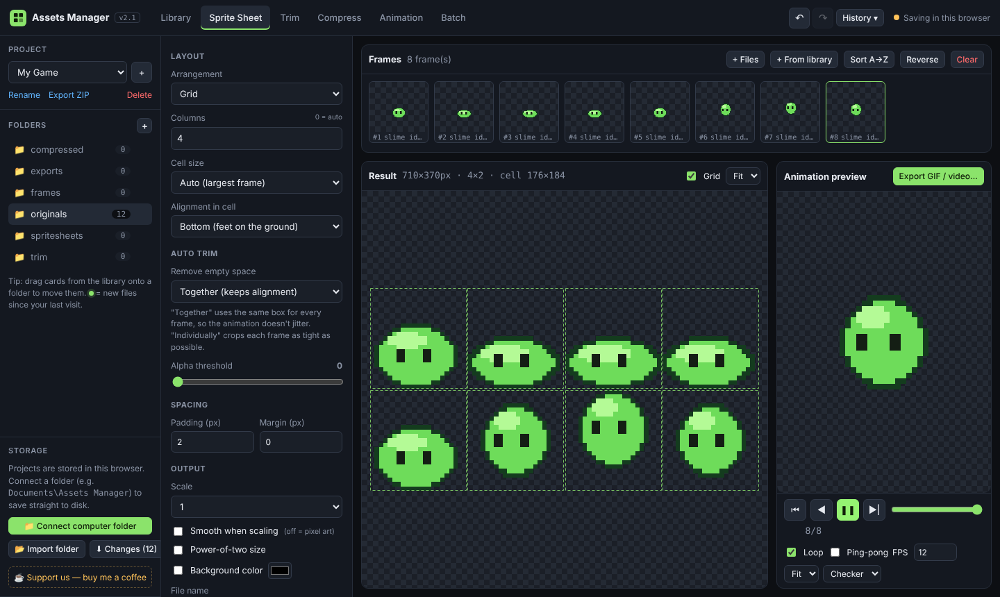
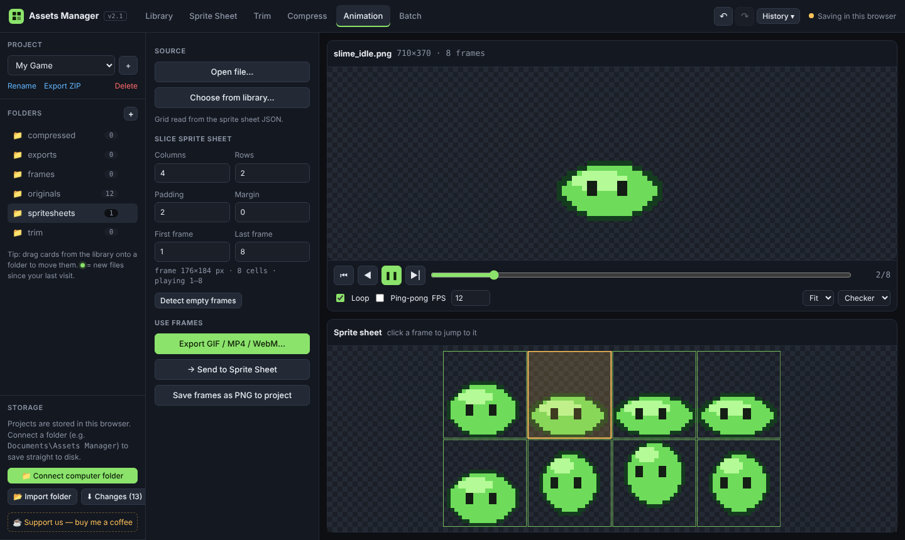
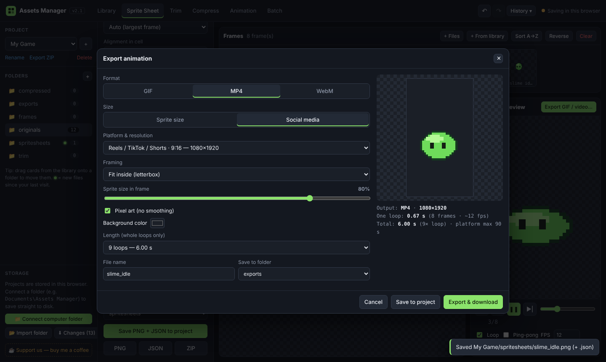
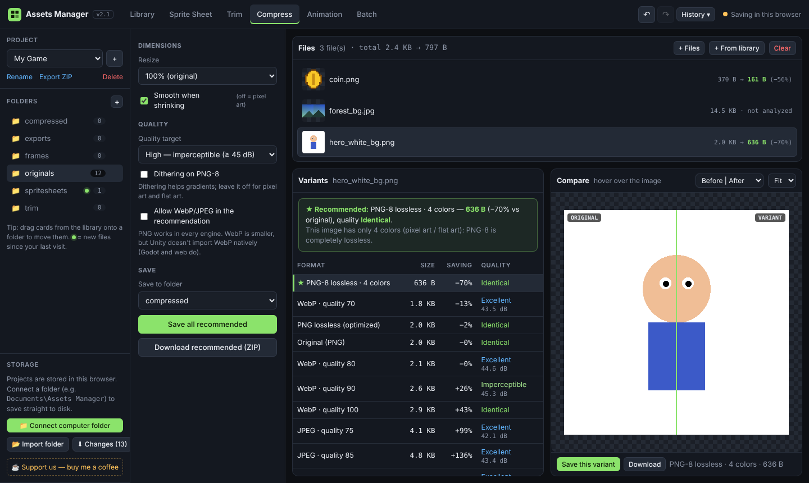
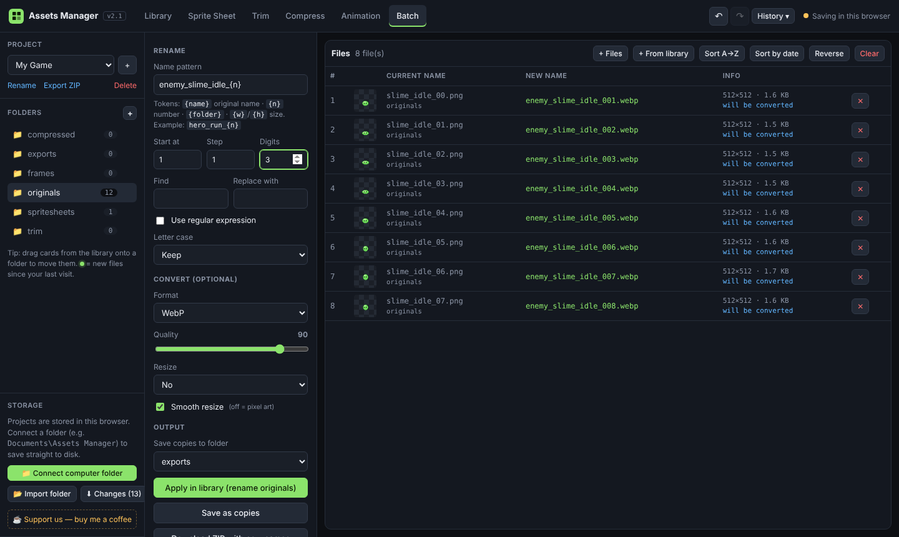
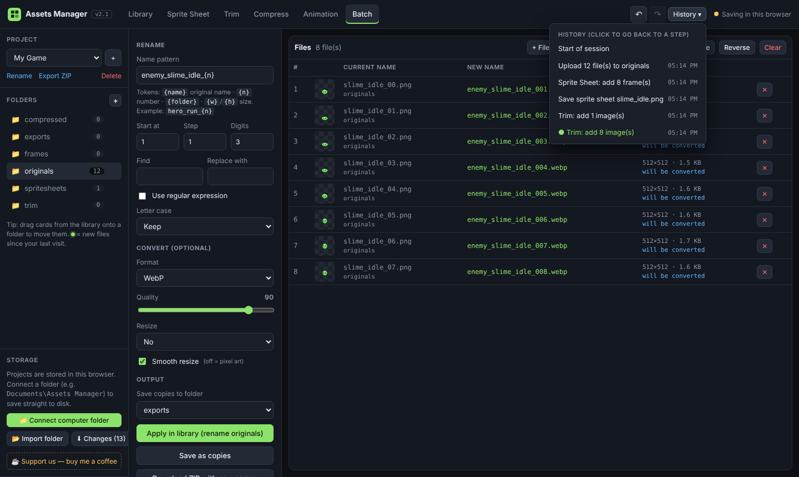

# Assets Manager — Tutorial

This guide takes you from raw exports of your drawing app to engine-ready sprite sheets, compressed files and shareable animations.

> **Tip:** use Chrome or Edge on desktop for the full feature set (folder saving and MP4/WebM export).

**Contents**
1. [First steps: projects, folders and storage](#1-first-steps-projects-folders-and-storage)
2. [Library](#2-library)
3. [Trim and background removal](#3-trim-and-background-removal)
4. [Sprite Sheet](#4-sprite-sheet)
5. [Animation player](#5-animation-player)
6. [Export GIF / MP4 / WebM (and social media)](#6-export-gif--mp4--webm-and-social-media)
7. [Compress](#7-compress)
8. [Batch rename and convert](#8-batch-rename-and-convert)
9. [Undo and history](#9-undo-and-history)
10. [A complete workflow example](#10-a-complete-workflow-example)
11. [FAQ and troubleshooting](#11-faq-and-troubleshooting)

---

## 1. First steps: projects, folders and storage

When you open the app for the first time, it creates a project called **My Game** with these folders:

| Folder | Used for |
|---|---|
| `originals` | Raw files you upload (default upload target) |
| `trim` | Output of the Trim tool |
| `spritesheets` | Sprite sheets (`.png` + `.json`) |
| `compressed` | Output of the Compress tool |
| `frames` | Frames extracted from GIFs or videos |
| `exports` | GIF / MP4 / WebM exports and batch copies |

**Projects** (left sidebar, top):
- **+** creates a new project with the default folders. Use one project per game.
- **Rename** renames the current project.
- **Export ZIP** downloads the whole project, with its folder structure.
- **Delete** removes the project. You can undo this while the page stays open.

**Folders** (left sidebar):
- **+** creates a folder (e.g. `characters`, `ui`, `scenery`).
- The number on the right is how many files the folder holds.
- A **green dot** means new files arrived since you last opened that folder. New files also get a **NEW** badge in the library.

### Where are my files stored?
The bottom-left **Storage** panel shows it:

- **Saving in this browser** (default): files live in the browser's storage on this computer. They stay there between visits, but clearing site data erases them. Use **Export ZIP** for backups.
- **Local folder** (Chrome/Edge): click **📁 Connect computer folder** and choose a folder, for example `Documents\Projetos\Assets Manager`. Every project becomes a sub-folder and every save writes a real file you can open in your engine or file explorer. Files your drawing app exports into those folders show up in the library too, with the green "new" dot.
  - The browser asks for permission once. If it asks again after a restart, click **Reconnect**.
  - Use **Copy browser projects → folder** to move work you did before connecting.

### Firefox, Safari and other browsers: Import folder + Download changes
Only Chrome and Edge let a website write to a folder directly. In every other browser, keep your folder in sync in two steps:

1. **📂 Import folder** (Storage panel): pick your `Assets Manager` folder, or a single project folder. Choose how to read it:
   - *contains my projects*: `Assets Manager/<project>/<folder>/files` creates one project per sub-folder
   - *is one project*: `<project>/<folder>/files`
   - *add into the current project*: `<folder>/files`
   Tick **Replace files that already exist** to refresh files you edited outside the app. Atlas `.json` files next to sprite sheets are read too.
2. Work normally. The **⬇ Changes (N)** button counts files created or modified since the import.
3. Click **⬇ Changes** to download a ZIP named like `My Game_changes_2026-10-28_1713.zip`. It already has the `My Game/<folder>/file` structure. **Extract it into your `Assets Manager` folder** and choose *Replace*. The counter then goes back to 0.

> Deleted or renamed files are not removed from your disk by the ZIP; remove the old copies by hand. Chrome/Edge's **Connect computer folder** doesn't have this limitation.

---

## 2. Library

- **Upload**: click **⬆ Upload files** or drag files onto the grid. Supported formats: PNG, JPG, WebP, GIF, SVG, BMP, AVIF, MP4, WebM and MOV (if your browser can play it).
  - Uploading a sprite sheet **together with its `.json` atlas** (same file name) keeps its grid information.
- **Select**: click a card. **Ctrl+click** adds or removes it, **Shift+click** selects a range, **Ctrl+A** selects everything visible and **Esc** clears the selection.
- **Open**: double-click a card for a large preview with zoom, rename, download and delete.
- **Filter**: type in the search box to filter by name.
- **Send to ▾**: sends the selected files to a tool (Sprite Sheet, Trim, Compress, Animation, Batch), or **moves** them to another folder (or a new one).
- **Move by dragging**: drag cards onto a folder in the sidebar.
- **Download**: one file downloads as is; several files download as a ZIP. Sprite sheets include their `.json`.
- **Delete**: removes the selected files. **Ctrl+Z** brings them back.

---

## 3. Trim and background removal

Drawing apps usually export each frame at the full canvas size (e.g. 512×512), with the drawing in the middle. Trim cuts away that empty space.

1. In the library, select the images → **Send to → Trim** (or drop files in the Trim tab).
2. Each card shows the **original** with a pink dashed box (the area that will be kept) and the **result** on the right, with the size before → after.

### Automatic crop options
- **Alpha threshold**: raise it to ignore nearly invisible pixels (stray brush dirt, soft shadows).
- **Crop box**:
  - *Individual*: each image is cropped as tightly as possible.
  - *Together*: every image uses **the same box** (the union of all of them). Use this for **animation frames**, so the character doesn't jump around.
- **Extra margin**: adds transparent pixels around the crop.
- **Round size to multiple of**: makes the size a multiple of 2/4/8/16/32 (some engines and compression formats like this).

### Manual crop
Click **✎ Edit area** (or click the left thumbnail) to open the crop editor:

- **Drag inside** the green box to move it.
- **Drag the handles** to resize it.
- **Drag anywhere else** to draw a new area.
- Type exact **X / Y / W / H** values if you prefer.
- **Apply**: uses this area for this image (the card gets a blue **MANUAL** tag).
- **Apply to all images**: uses the same area for every image in the list.
- **Use auto crop**: removes the manual area and goes back to automatic.

### Remove a solid background
For art exported on white (or any flat color):
1. Tick **Remove a solid background**.
2. **Method**:
   - *Flood from edges* (recommended) removes only background that is **connected to the image borders**. White eyes or highlights inside the character are kept.
   - *Every matching color* removes that color everywhere.
3. **Background color**: *Auto* reads the four corners. *Custom* lets you pick a color, or use the **💧 Eyedropper** to click anywhere on the screen (Chrome/Edge).
4. **Tolerance**: how different a pixel can be and still count as background. Raise it for JPG noise.
5. **Edge softness**: creates semi-transparent edges instead of jagged ones.
6. **Clean color halo on edges**: removes the white or colored fringe around anti-aliased edges.

### Save
- **Save all to project**: saves to the chosen folder (default `trim`) with the **name suffix** (default `_trim`).
- **Replace the originals in the library**: overwrites the source files instead (as PNG). This can be undone with Ctrl+Z.
- **Download ZIP**, or **→ Sprite Sheet** to send the trimmed images straight to the sheet maker.

---

## 4. Sprite Sheet

1. Select your frames in the library → **Send to → Sprite Sheet**. You can also use **+ Files** / **+ From library**, or drop files.
   - **GIFs** are split into all their frames automatically.
   - **Videos** ask for FPS, start/end time and max frames, then extract the frames.
2. **Order the frames**: drag them in the *Frames* strip. Hover a frame for ◀ ▶ (move), ⧉ (duplicate) and ✕ (remove). **Sort A→Z** and **Reverse** are also available. Every change can be undone.
3. **Layout**: *Grid* (with a number of **columns**; 0 = automatic square-ish grid), *Horizontal strip* or *Vertical strip*.
4. **Cell size**: *Auto* uses the largest frame. *Custom* forces a cell size, e.g. 64×64.
5. **Alignment in cell**: *Bottom (feet on the ground)* keeps characters standing on the same line when frames have different heights.
6. **Auto trim**: *Together* is the recommended setting for animations.
7. **Spacing**: *Padding* goes between cells, *Margin* around the whole sheet. 1–2 px of padding helps avoid texture bleeding in engines.
8. **Output**: *Scale* (use 2×/4× with **Smooth** off for crisp pixel art), *Power-of-two size*, *Background color*.
9. Check the **Result** (toggle *Grid* to see the cells) and the **Animation preview** on the right.
10. **Save PNG + JSON to project**, or download the **PNG**, **JSON** or both as a **ZIP**.

> The JSON is a standard atlas (*hash* format) with one entry per frame, an `animations` list and the grid info. Phaser, PixiJS and most TexturePacker importers can read it. In Godot or Unity you can slice the PNG by grid using the cell size shown next to *Result*.

---

## 5. Animation player

Open any GIF, video or sprite sheet (**Send to → Animation**, **Open file…**, or drop it on the player).

- **Controls**: ⏮ first frame, ◀ / ▶| step frames, ▶/❚❚ play-pause (**Space**), the scrub bar, **Loop**, **Ping-pong** (forward then backward), **FPS**, **zoom** and **background** (checker, black, white, gray, green, magenta).
- **GIFs** play with their original frame timing ("GIF timing"). Untick it to try another FPS.
- **Sprite sheets**: set **Columns / Rows** (read automatically from the `.json` when available), **Padding / Margin**, and the **First / Last frame** to preview one animation. **Detect empty frames** ignores empty cells at the end. The map below shows the sheet; click a cell to jump to it.
- **Videos**: native controls, **Speed** and **Loop**. Use **Extract frames** (FPS, max frames, start/end, optional background removal) to turn the clip into frames.
- **Use frames**: **Export GIF / MP4 / WebM…**, **→ Send to Sprite Sheet** or **Save frames as PNG to project**.

---

## 6. Export GIF / MP4 / WebM (and social media)

Open it from **Export GIF / video…** in the Sprite Sheet preview, or **Export GIF / MP4 / WebM…** in the Animation tab. The export uses the player's current **FPS** and **Ping-pong** setting.

1. **Format**: **GIF** (works everywhere and supports transparency), **MP4** (H.264, best for social media) or **WebM** (VP9, smaller; transparency only if your browser supports it).
2. **Size**:
   - **Sprite size**: 1×–16× the frame size, perfect for devlogs, wikis or itch.io.
   - **Social media**: pick a platform preset (Instagram post 1:1 or 4:5, Reels/TikTok/Shorts 9:16, Stories, YouTube 16:9, X, LinkedIn, Facebook, Bluesky, Discord, Steam, itch.io), then:
     - **Framing**: *Fit inside* (letterbox with background color) or *Fill frame* (crop).
     - **Sprite size in frame**: how much of the frame the sprite occupies.
3. **Pixel art (no smoothing)**: keeps hard pixel edges when scaling up.
4. **Transparent background / Background color**.
5. **Length (whole loops only)**: the duration is always a **multiple of one loop**, so the animation never cuts in the middle. If one loop lasts 3 s you can choose 3 s, 6 s, 9 s… up to the platform's maximum. For GIF you can instead choose **repeats forever**.
6. **Export & download**, or **Save to project** (default folder `exports`).

---

## 7. Compress

1. Select images → **Send to → Compress** (PNG, JPG, WebP, BMP, AVIF).
2. For each file, the tool creates several variants:
   - **Original**
   - **PNG lossless (optimized)**: same pixels, re-encoded
   - **PNG-8 lossless**: when the image has ≤ 256 colors (typical for pixel art), a palette PNG with **zero** quality loss and much smaller
   - **PNG-8 with 256/128/64/32/16 colors**
   - **WebP** quality 100/90/80/70, and **JPEG** 92/85/75 for images without transparency
3. Each variant shows its **size**, **saving** and **quality** (Identical, Imperceptible ≥45 dB, Excellent ≥40 dB, Good ≥35 dB, Visible loss).
4. **★ Recommended** = the smallest file that meets your **Quality target**.
   - By default only PNG (and the original format) can be recommended, because PNG works in every engine. Tick **Allow WebP/JPEG in the recommendation** for web games or Godot (Unity doesn't import WebP natively).
5. Click any variant to inspect it in **Compare**: hover to move the before/after divider, or switch to **Difference (×8)** to see where it changed.
6. **Resize** (75/50/25%) creates smaller versions (turn **Smooth** off for pixel art).
7. **Save this variant**, **Save all recommended** (default folder `compressed`) or **Download recommended (ZIP)**.

---

## 8. Batch rename and convert

1. Select files → **Send to → Batch** (or **+ From library**). Drag rows to set the numbering order, or use **Sort A→Z / Sort by date / Reverse**.
2. **Name pattern** tokens:
   - `{name}`: the original name without extension
   - `{n}`: a number (**Start at**, **Step**, **Digits**: `{n}` with 3 digits gives `001, 002…`)
   - `{folder}`, `{w}`, `{h}`: folder, width and height
   - Example: `enemy_slime_idle_{n}` gives `enemy_slime_idle_001.png`, `enemy_slime_idle_002.png`…
3. **Find / Replace with** (tick **Use regular expression** for regex).
4. **Letter case**: lowercase, UPPERCASE, snake_case, kebab-case, camelCase or PascalCase.
5. Optional **Convert** (PNG/WebP/JPG + quality) and **Resize** (percentage, or fit inside a max size).
6. The table shows **current → new name** live. Duplicates turn red; they get a suffix automatically.
7. Apply:
   - **Apply in library (rename originals)**: renames the library files in place (undo with Ctrl+Z).
   - **Save as copies**: writes the renamed/converted copies to the chosen folder (default `exports`).
   - **Download ZIP with new names**.

---

## 9. Undo and history

- **↶ / ↷** in the top bar, or **Ctrl+Z / Ctrl+Shift+Z** (also **Ctrl+Y**).
- **History ▾** lists every action with its time. Click any entry to go back (or forward) to that point.
- What can be undone: uploads, deletes, moves, renames, every save from the tools, trim/batch replacements, folder and project create/delete/rename, sprite sheet frame changes and trim crop edits.
- History is kept **while the page is open**. Reloading the page clears it.

---

## 10. A complete workflow example

*Goal: an idle animation for an enemy, ready for the engine and for Instagram.*

1. Export the 8 frames from your drawing app into `Assets Manager/My Game/originals/` (or upload them).
2. **Library** → select them → **Send to → Batch** → pattern `slime_idle_{n}`, 2 digits → **Apply in library**.
3. **Send to → Sprite Sheet** → Auto trim *Together*, alignment *Bottom*, 4 columns, padding 2 → **Save PNG + JSON**.
4. Click **Export GIF / video…** → **MP4**, **Social media**, *Reels / TikTok / Shorts*, length 6 s (whole loops) → **Save to project**.
5. In `spritesheets`, select the sheet → **Send to → Compress** → **Save this variant** (★ recommended).
6. Import `spritesheets/slime_idle.png` (+ `.json`) into your engine. 🎮

---

## 11. FAQ and troubleshooting

**I use Firefox / Safari. How do I work with my folder?**
Use **📂 Import folder** and **⬇ Changes** in the Storage panel (see [section 1](#firefox-safari-and-other-browsers-import-folder--download-changes)). The "Connect computer folder" button only appears in Chrome and Edge.

**MP4/WebM buttons are disabled.**
Your browser doesn't support video encoding (WebCodecs). Use Chrome or Edge, or export a GIF.

**My video won't open.**
Browsers only play some codecs. MP4 with H.264 or WebM work best. Convert other formats first.

**Where did my files go after clearing browser data?**
In browser storage mode they are deleted with the site data. Keep backups with **Export ZIP**, or connect a computer folder.

**The online app didn't update.**
It works offline through a cache. Close every tab of the app and open it again (or press Ctrl+F5).

**How can I support the project?**
☕ [buymeacoffee.com/drehdantas](https://buymeacoffee.com/drehdantas). Thank you!

**How do I report a bug or suggest a feature?**
Open an issue at https://github.com/drehdantas/assets-manager/issues.
